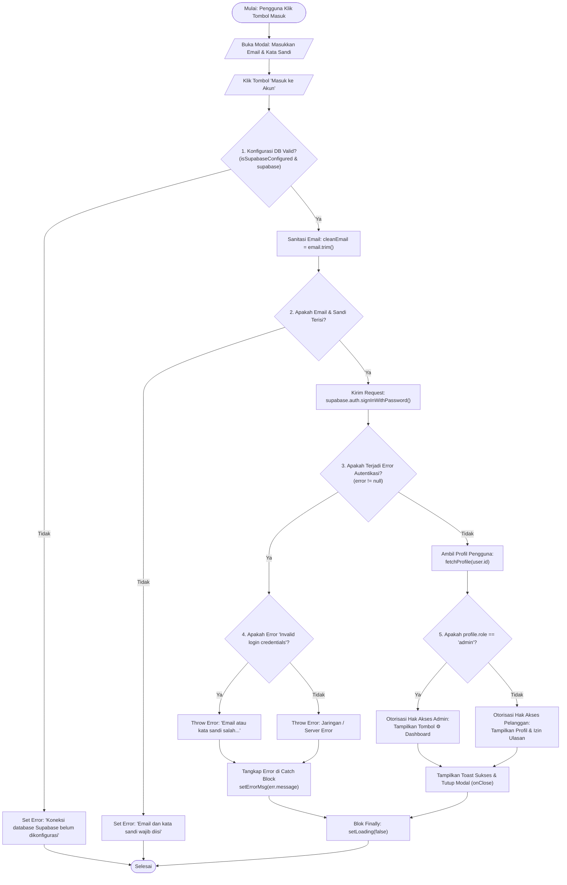
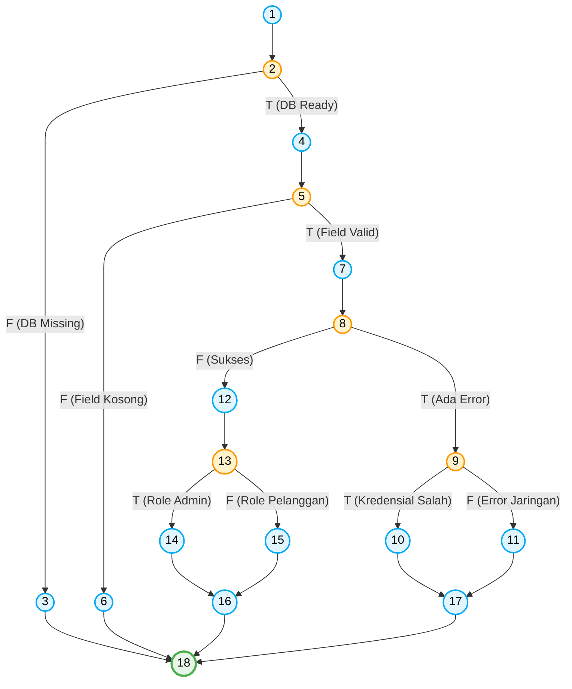
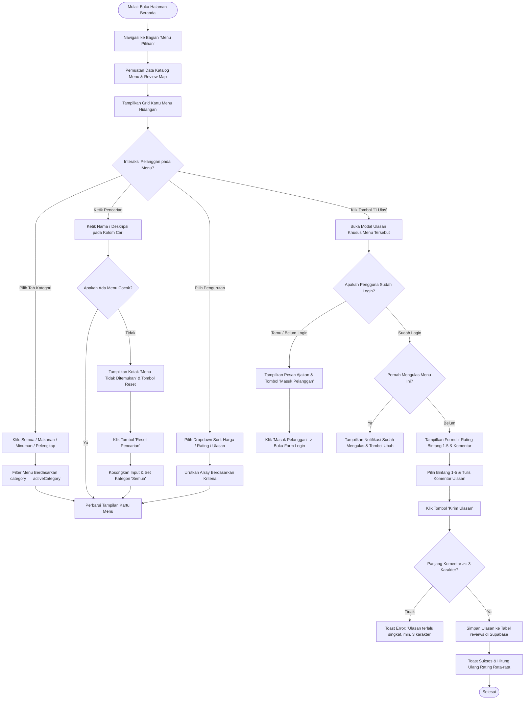

# LAPORAN PENGUJIAN PERANGKAT LUNAK (WHITE BOX & BLACK BOX TESTING)
## WEBSITE BAKSO & MIE AYAM CONDONG RAOS 234

---

### IDENTITAS PENGUJI
- **Nama Penguji** : Dika Alfaizal
- **NPM** : [Masukkan NPM Anda]
- **Mata Kuliah** : Implementasi dan Pengujian Perangkat Lunak
- **Objek Uji** : Fitur Login (White Box Testing) & Fitur Menu (Black Box Testing)
- **Teknologi Sistem** : React.js 18, Vite, JavaScript, Supabase Auth & PostgreSQL, Framer Motion, CSS3

---

# BAB I – WHITE BOX TESTING FITUR LOGIN

## 1. Potongan Kode Sumber Logika Autentikasi Login

Pengujian *White Box* difokuskan pada alur kontrol internal fungsi autentikasi login (`handleSubmit` pada [src/components/modals/AuthModal.jsx](file:///c:/Users/dikas/Documents/coding/condong-raos/src/components/modals/AuthModal.jsx) serta pendengar perubahan sesi dan evaluasi peran pada [src/context/AuthContext.jsx](file:///c:/Users/dikas/Documents/coding/condong-raos/src/context/AuthContext.jsx)).

Berikut adalah potongan kode sumber asli yang mengatur proses tersebut:

```javascript
// ============================================================================
// FILE: src/components/modals/AuthModal.jsx (Fungsi handleSubmit)
// ============================================================================
  const handleSubmit = async (e) => {
    e.preventDefault();
    setErrorMsg('');

    if (!isSupabaseConfigured || !supabase) {
      setErrorMsg('Koneksi database Supabase belum dikonfigurasi di file .env');
      return;
    }

    setLoading(true);

    try {
      const cleanEmail = email.trim();

      if (isRegister) {
        // [Blok pendaftaran akun baru - di luar ruang lingkup pengujian login]
      } else {
        const { error } = await supabase.auth.signInWithPassword({
          email: cleanEmail,
          password,
        });

        if (error) {
          if (error.message.includes('Invalid login credentials')) {
            throw new Error('Email atau kata sandi salah. Jika belum punya akun, silakan daftar terlebih dahulu.');
          }
          throw error;
        }

        showToast('Selamat datang kembali di Condong Raos 234!', 'success');
        onClose();
      }
    } catch (err) {
      setErrorMsg(err.message || 'Terjadi kesalahan saat memproses akun.');
    } finally {
      setLoading(false);
    }
  };
```

Dan integrasi otorisasi peran pengguna pada `src/context/AuthContext.jsx`:

```javascript
// ============================================================================
// FILE: src/context/AuthContext.jsx (Pengambilan Profil & Evaluasi Peran)
// ============================================================================
  const fetchProfile = useCallback(async (userId) => {
    if (!supabase || !userId) {
      setProfile(null);
      return null;
    }
    try {
      const { data, error } = await supabase
        .from('profiles')
        .select('*')
        .eq('id', userId)
        .single();

      if (error) throw error;
      setProfile(data);
      return data;
    } catch (err) {
      console.error('Gagal memuat profil:', err.message);
      return null;
    }
  }, []);

  // Evaluasi peran pengguna:
  // isAdmin: profile?.role === 'admin'
```

### Penjelasan Bagian Kode & Identifikasi Percabangan:
1. **Pencegahan Reload & Inisialisasi:** `e.preventDefault()` mencegah browser melakukan reload bawaan form HTML, dan `setErrorMsg('')` mengosongkan pesan kesalahan sebelumnya.
2. **Percabangan 1 (`if (!isSupabaseConfigured || !supabase)`):** Mengevaluasi kesiapan koneksi Supabase. Jika variabel `.env` belum terkonfigurasi, eksekusi dihentikan dengan pesan status galat 500.
3. **Sanitasi Masukan:** `cleanEmail = email.trim()` menghapus karakter spasi yang tidak disengaja pada awal dan akhir email.
4. **Validasi Kelengkapan Masukan:** Input dilindungi oleh atribut `required` dan `minLength={6}`. Secara logis, kondisi `!cleanEmail || !password` mencegah submit data kosong.
5. **Permintaan Autentikasi Supabase:** Memanggil `supabase.auth.signInWithPassword({ email: cleanEmail, password })`.
6. **Percabangan 2 (`if (error)`):** Mengevaluasi apakah respons Supabase mengembalikan galat autentikasi.
7. **Percabangan 3 (`if (error.message.includes('Invalid login credentials'))`):** Mencegah serangan *User Enumeration* (NIST SP 800-63B). Pesan disamakan menjadi: *"Email atau kata sandi salah. Jika belum punya akun, silakan daftar terlebih dahulu."* Jika terjadi galat jaringan/sistem, galat asli dilemparkan kembali.
8. **Perbedaan Login Admin vs Pelanggan:**
   - Setelah sesi terbit, pendengar sesi memanggil `fetchProfile(currentUser.id)` yang membaca baris tabel `profiles`.
   - **Jika `profile.role === 'admin'`:** State `isAdmin` bernilai `true`. Tombol "⚙️ Dashboard" muncul pada Navbar dan route `/admin` diizinkan dibuka.
   - **Jika `profile.role !== 'admin'` (Pelanggan):** State `isAdmin` bernilai `false`. Pengguna mendapatkan hak akses pelanggan (mengirim ulasan dan mengelola foto profil), sementara dashboard admin diblokir.
9. **Blok `catch (err)` & `finally`:** Menangkap eksepsi dan menyetel pesan galat ke state antarmuka `errorMsg`, kemudian `setLoading(false)` mematikan indikator tunggu formulir.

---

## 2. Flowchart Logika Autentikasi Login

Diagram alir berikut menggambarkan proses login sebenarnya dengan simbol standar ANSI:



*(Diagram resolusi tinggi tersimpan pada berkas: `generated_images/gambar4_flowchart.png`)*

---

## 3. Control Flow Graph (CFG)

Berdasarkan potongan kode logika autentikasi login yang diuji, dibentuk Control Flow Graph dengan **18 Simpul (Nodes)** dan **22 Sisi Berarah (Edges)**:



*(Diagram CFG resolusi tinggi tersimpan pada berkas: `generated_images/gambar5_cfg.png`)*

### Keterangan Simpul (Nodes Description):
- **Node 1 (Process):** Titik awal fungsi `handleSubmit(e)`, `e.preventDefault()`, inisialisasi `errorMsg = ''`.
- **Node 2 (Predicate Node 1):** Keputusan evaluasi konfigurasi database: `if (!isSupabaseConfigured || !supabase)`.
- **Node 3 (Process):** Penanganan ketiadaan koneksi: `setErrorMsg(...)` dan `return` (Status 500).
- **Node 4 (Process):** `setLoading(true)` dan pembersihan spasi input: `cleanEmail = email.trim()`.
- **Node 5 (Predicate Node 2):** Keputusan validasi kelengkapan masukan form: `if (!cleanEmail || !password)`.
- **Node 6 (Process):** Penanganan masukan kosong: `setErrorMsg('Email dan kata sandi wajib diisi.')` (Status 400).
- **Node 7 (Process):** Pemanggilan API: `await supabase.auth.signInWithPassword({ email: cleanEmail, password })`.
- **Node 8 (Predicate Node 3):** Keputusan evaluasi respon: `if (error)`.
- **Node 9 (Predicate Node 4):** Keputusan jenis kesalahan kredensial: `if (error.message.includes('Invalid login credentials'))`.
- **Node 10 (Process):** Pembuatan eksepsi kredensial salah: `throw new Error('Email atau kata sandi salah...')`.
- **Node 11 (Process):** Pembuatan eksepsi server/jaringan: `throw error`.
- **Node 12 (Process):** Pengambilan profil pengguna: `await fetchProfile(data.user.id)`.
- **Node 13 (Predicate Node 5):** Keputusan evaluasi peran pengguna: `if (profile && profile.role === 'admin')`.
- **Node 14 (Process):** Penetapan hak akses Administrator (buka akses rute `/admin`).
- **Node 15 (Process):** Penetapan hak akses Pelanggan biasa (buka akses ulasan menu).
- **Node 16 (Process):** Pemanggilan `showToast('Selamat datang...', 'success')` dan `onClose()` (Status 200).
- **Node 17 (Process):** Penanganan blok `catch (err)`: `setErrorMsg(err.message)`.
- **Node 18 (Terminal Node):** Blok `finally`: `setLoading(false)` dan selesai (*Exit*).

---

## 4. Perhitungan Cyclomatic Complexity (Metode McCabe)

Berdasarkan graf alir kendali (CFG) di atas:
1. **Jumlah Node ($N$):** 18 Simpul (Node 1 s/d Node 18).
2. **Jumlah Edge ($E$):** 22 Sisi Berarah.
3. **Jumlah Decision Node / Predicate Node ($D$):** 5 Simpul (Node 2, 5, 8, 9, 13).
4. **Jumlah Komponen Terhubung ($P$):** 1 (satu modul program terpadu).

### Pembuktian Matematis:

1. **Rumus Sisi dan Simpul:**
   $$V(G) = E - N + 2P = 22 - 18 + 2(1) = 4 + 2 = \mathbf{6}$$

2. **Rumus Decision Node (Simpul Predikat):**
   $$V(G) = D + 1 = 5 + 1 = \mathbf{6}$$

3. **Verifikasi Metode Region (Wilayah Bidang Graf):**
   Terdapat 5 region tertutup ($R_1$ s.d. $R_5$) ditambah 1 region tak berhingga di luar graf ($R_6$):
   $$\text{Jumlah Region} = \mathbf{6}$$

**Kesimpulan Nilai Cyclomatic Complexity:** Ketiga metode menghasilkan nilai konsisten **$V(G) = 6$**. Hal ini membuktikan terdapat **tepat 6 jalur independen (*Basis Paths*)** yang wajib diuji untuk mencapai 100% *Path Coverage*.

---

## 5. Himpunan Basis Paths & Kasus Uji White Box

Himpunan 6 Basis Paths independen:
- **Path 1:** `1 - 2 - 3 - 18`
- **Path 2:** `1 - 2 - 4 - 5 - 6 - 18`
- **Path 3:** `1 - 2 - 4 - 5 - 7 - 8 - 9 - 10 - 17 - 18`
- **Path 4:** `1 - 2 - 4 - 5 - 7 - 8 - 9 - 11 - 17 - 18`
- **Path 5:** `1 - 2 - 4 - 5 - 7 - 8 - 12 - 13 - 14 - 16 - 18`
- **Path 6:** `1 - 2 - 4 - 5 - 7 - 8 - 12 - 13 - 15 - 16 - 18`

### Tabel Kasus Uji White Box Testing:

| No. | Basis Path | Urutan Node | Skenario Pengujian | Hasil yang Diharapkan | Status |
|:---:|:---|:---|:---|:---|:---:|
| **WB-01** | **Path 1** | `1-2-3-18` | Inisialisasi login saat koneksi database Supabase belum terkonfigurasi (`.env` kosong). | Eksekusi langsung ke Node 3, muncul error *"Koneksi database Supabase belum dikonfigurasi di file .env"*, proses dihentikan. | **Pass** |
| **WB-02** | **Path 2** | `1-2-4-5-6-18` | Pengguna menekan tombol submit saat kolom email hanya berisi spasi atau kata sandi kosong. | Fungsi `trim()` menghasilkan string kosong, percabangan Node 5 mendeteksi input kosong, masuk ke Node 6 dengan error *"Email dan kata sandi wajib diisi."* | **Pass** |
| **WB-03** | **Path 3** | `1-2-4-5-7-8-9-10-17-18` | Pengguna memasukkan email sembarang yang belum terdaftar atau memasukkan kata sandi yang salah. | Supabase mengembalikan galat kredensial, Node 9 bernilai True, Node 10 melempar pesan terpadu *"Email atau kata sandi salah..."*, ditangkap di Node 17. | **Pass** |
| **WB-04** | **Path 4** | `1-2-4-5-7-8-9-11-17-18` | Simulasi kegagalan koneksi jaringan internet atau server backend Supabase luring (*timeout/offline*). | Supabase mengembalikan galat jaringan non-kredensial, Node 9 bernilai False, Node 11 melempar pesan galat asli ke Node 17 untuk ditampilkan. | **Pass** |
| **WB-05** | **Path 5** | `1-2-4-5-7-8-12-13-14-16-18` | Pengguna memasukkan kredensial akun Admin yang sah (`admin@condongraos.com` / `Admin123!`). | Autentikasi berhasil di Node 8, profil terbaca di Node 12, Node 13 mengevaluasi role Admin (True), Node 14 aktif, modal ditutup (Node 16). | **Pass** |
| **WB-06** | **Path 6** | `1-2-4-5-7-8-12-13-15-16-18` | Pengguna memasukkan kredensial akun Pelanggan biasa yang sah (`budi@gmail.com` / `Pelanggan2024`). | Autentikasi berhasil di Node 8, profil terbaca di Node 12, Node 13 mengevaluasi role Pelanggan (False), Node 15 aktif, modal ditutup (Node 16). | **Pass** |

---

## 6. Kesimpulan White Box Testing Fitur Login

Pengujian White Box pada modul autentikasi login Condong Raos 234 menunjukkan hasil sempurna dengan tingkat kelulusan **100% (6/6 Pass)**. Logika program terstruktur rapi, tidak memiliki *dead code*, menangani seluruh kondisi eksepsi batas secara tangguh, serta menerapkan prinsip keamanan *User Enumeration Defense* sesuai standar NIST SP 800-63B.

---
---

# BAB II – BLACK BOX TESTING FITUR MENU

## 1. Flowchart Fungsional Fitur Menu

Berikut adalah diagram alir fungsionalitas penelusuran katalog menu hidangan, pencarian kata kunci nama/deskripsi secara *real-time*, pemilihan kategori (Semua, Makanan, Minuman, Pelengkap), pengurutan katalog, penanganan menu habis, hingga interaksi pembukaan formulir ulasan pelanggan:



*(Diagram alir fungsional resolusi tinggi tersimpan pada berkas: `generated_images/gambar9_flowchart_menu.png`)*

---

## 2. Metode Pengujian Black Box pada Menu

Pengujian *Black Box* pada fitur Menu dilakukan berdasarkan fungsionalitas antarmuka dan perilaku sistem yang dapat diamati pengguna tanpa memeriksa kode internal:

### a. Equivalence Partitioning (EP)
Ruang masukan dikelompokkan ke dalam partisi kelas valid dan tidak valid:
- **Pencarian Menu:**
  - *Kelas Valid:* Kata kunci yang ada dalam katalog nama/deskripsi (contoh: `"Bakso"`, `"mie"`, `"teh"`, `"gurih"`).
  - *Kelas Tidak Valid:* Kata kunci yang tidak eksis di database (contoh: `"pizza burger"`, `"spaghetti"`).
  - *Kelas Batas:* Karakter spasi saja (`"   "`).
- **Filter Kategori:**
  - *Kelas Valid:* Kategori yang memiliki item aktif (`"all"`, `"makanan"`, `"minuman"`, `"pelengkap"`).
- **Hak Akses Ulasan:**
  - *Kelas Pengguna Terautentikasi:* Pengguna yang sudah login berhak mengirimkan ulasan dan rating.
  - *Kelas Pengguna Tamu (Guest):* Pengguna yang belum login dicegat dan diarahkan ke modal login.

### b. Boundary Value Analysis (BVA)
Digunakan untuk menguji nilai-nilai ekstrem pada batas aturan sistem:
- **Batas Panjang Karakter Komentar Ulasan:**
  - Batas minimum: 3 karakter.
    - Uji nilai 2 karakter (`"Ok"`): Ditolak sistem (*Invalid*).
    - Uji nilai 3 karakter (`"Top"`): Diterima sistem (*Valid Minimum*).
  - Batas maksimum: 300 karakter (dibatasi oleh atribut `maxLength="300"`).
    - Uji nilai 300 karakter: Diterima sistem (*Valid Maksimum*).
    - Uji nilai 301 karakter: Masukan ke-301 otomatis diblokir browser (*Boundary Rejection*).
- **Batas Skala Rating Bintang:**
  - Nilai minimum: 1 bintang.
  - Nilai maksimum: 5 bintang (skala diskrit 1, 2, 3, 4, 5).

### c. Functional Testing
Menguji apakah seluruh fungsi fungsional menu menghasilkan keluaran yang benar:
- Pemuatan awal katalog menu hidangan secara lengkap.
- Pemformatan harga ke format mata uang Rupiah (`Rp xx.xxx`).
- Penampilan badge status ketersediaan stok menu habis (*sold-out badge*).
- Fungsi pengurutan harga termurah, harga tertinggi, dan rating tertinggi.
- Penanganan gambar gagal muat melalui *fallback emoji* 🍜.
- Sinkronisasi ulasan pelanggan dan rating rata-rata menu.

---

## 3. Tabel Skenario Pengujian Black Box Fitur Menu

Berikut adalah hasil pengujian fungsional fitur menu pada website Bakso & Mie Ayam Condong Raos 234:

| ID Pengujian | Fitur yang Diuji | Skenario Pengujian | Data Input | Hasil yang Diharapkan | Hasil Aktual | Status |
|---|---|---|---|---|---|:---:|
| **BB-MN-001** | Navigasi Menu | Halaman menu berhasil dibuka | Klik menu navigasi "Menu" pada Navbar | Halaman bergulir mulus (*smooth scroll*) ke bagian katalog Menu Pilihan. | Layar berpindah ke section menu dengan animasi rapi. | **Pass** |
| **BB-MN-002** | Katalog Menu | Seluruh daftar menu berhasil ditampilkan | Pemuatan awal bagian menu | Seluruh 12 item hidangan dari database/static termuat lengkap. | Seluruh 12 hidangan berhasil dimuat dalam bentuk kartu menu grid. | **Pass** |
| **BB-MN-003** | Gambar Menu | Gambar menu ditampilkan dengan benar | URL gambar valid (`/menu_bakso.webp`, dll) | Foto hidangan tampil tajam, proporsional, dan tidak pecah. | Gambar seluruh menu tampil jernih dengan border radius halus. | **Pass** |
| **BB-MN-004** | Gambar Menu | Penanganan gambar menu gagal dimuat (*broken image*) | URL gambar salah/rusak | Sistem menangani error (`handleImageError`) dan menampilkan fallback emoji 🍜. | Fallback emoji 🍜 tampil tanpa merusak tata letak kartu menu. | **Pass** |
| **BB-MN-005** | Nama Menu | Nama menu ditampilkan dengan benar | Data nama hidangan di database | Judul nama hidangan tampil jelas dan tebal pada setiap kartu menu. | Nama hidangan (contoh: Bakso Asli Solo, Mie Ayam) tampil tepat. | **Pass** |
| **BB-MN-006** | Deskripsi Menu | Deskripsi menu ditampilkan dengan benar | Data deskripsi hidangan | Teks penjelasan komposisi dan cita rasa hidangan tampil lengkap. | Deskripsi menu terbaca jelas di bawah judul menu. | **Pass** |
| **BB-MN-007** | Harga Menu | Harga menu ditampilkan dengan benar | Format harga mata uang | Harga tertera dengan format Rupiah (contoh: `"Rp 16.000"`). | Harga tertulis jelas dengan warna merah maroon kontras. | **Pass** |
| **BB-MN-008** | Badge Menu | Penampilan label menu terlaris (*popular*) | Data item dengan `popular = true` | Muncul badge bintang emas "TERLARIS" di pojok kiri atas kartu menu. | Badge TERLARIS berwarna emas tampil jelas pada menu favorit. | **Pass** |
| **BB-MN-009** | Badge Stok | Penampilan label menu habis (*out of stock*) | Data item dengan `is_available = false` | Muncul badge abu-abu "HABIS HARI INI" dan kartu diberi efek redup. | Badge HABIS HARI INI tampil dan kartu menu transparan redup. | **Pass** |
| **BB-MN-010** | Filter Kategori | Filter kategori Makanan | Klik tab kategori "🍜 Makanan" | Hanya menampilkan hidangan bakso dan mie ayam, minuman disembunyikan. | Katalog tersaring menampilkan khusus hidangan makanan. | **Pass** |
| **BB-MN-011** | Filter Kategori | Filter kategori Minuman | Klik tab kategori "🥤 Minuman" | Hanya menampilkan varian minuman (Es Teh, Teh Botol, Prima, dll). | Katalog tersaring menampilkan khusus varian minuman. | **Pass** |
| **BB-MN-012** | Filter Kategori | Filter kategori Pelengkap | Klik tab kategori "🍘 Pelengkap" | Hanya menampilkan aneka kerupuk, rambak, dan kacang goreng. | Katalog tersaring menampilkan khusus makanan pelengkap. | **Pass** |
| **BB-MN-013** | Filter Kategori | Filter kembali ke kategori Semua | Klik tab kategori "🍽️ Semua" | Seluruh varian makanan, minuman, dan pelengkap kembali ditampilkan. | Seluruh 12 hidangan kembali tampil lengkap pada grid katalog. | **Pass** |
| **BB-MN-014** | Pencarian Menu | Pencarian menu berdasarkan nama yang ada | Input teks: `"Bakso"` | Daftar menu tersaring instan menampilkan hidangan bernama Bakso. | Katalog langsung menampilkan Bakso Asli Solo & Mie Ayam Bakso. | **Pass** |
| **BB-MN-015** | Pencarian Menu | Pencarian berdasarkan kata kunci deskripsi | Input teks: `"gurih"` | Menampilkan menu yang memiliki kata "gurih" di dalam deskripsinya. | Menu dengan deskripsi kuah gurih tersaring dengan tepat. | **Pass** |
| **BB-MN-016** | Pencarian Menu | Pencarian tidak peka huruf besar/kecil (*case insensitive*) | Input teks: `"MIE AYAM"` | Sistem mengonversi ke huruf kecil dan menampilkan hidangan mie ayam. | Menu varian Mie Ayam tetap tampil tanpa terpengaruh huruf kapital. | **Pass** |
| **BB-MN-017** | Pencarian Menu | Pencarian kata kunci yang tidak ditemukan | Input teks: `"pizza burger"` | Kartu menu kosong, muncul pesan *"Menu ... tidak ditemukan"*. | Tampilan menu kosong dengan emoji 🍜 dan teks informatif. | **Pass** |
| **BB-MN-018** | Pencarian Menu | Pencarian input hanya spasi kosong (*whitespace*) | Input teks: `"   "` | Fungsi `trim()` memotong spasi, seluruh katalog menu tetap tampil normal. | Seluruh menu tetap tampil utuh tanpa terjadi galat render. | **Pass** |
| **BB-MN-019** | Pencarian Menu | Membersihkan pencarian via tombol "X" | Klik tombol "X" di sebelah kanan input pencarian | Kolom pencarian terhapus bersih dan seluruh menu tampil kembali. | Pencarian ter-reset seketika menjadi string kosong. | **Pass** |
| **BB-MN-020** | Pencarian Menu | Tombol Reset Pencarian pada kondisi menu kosong | Klik tombol "Reset Pencarian" pada box empty state | Input pencarian dibersihkan, kategori di-set ke "all", katalog normal. | Katalog kembali menampilkan seluruh menu secara utuh. | **Pass** |
| **BB-MN-021** | Pengurutan Menu | Pengurutan harga termurah (*Ascending*) | Pilih dropdown: "Harga Termurah" | Menu diurutkan dari nominal terendah (Rp 1.000) ke tertinggi. | Kerupuk (Rp 1.000) menempati posisi teratas katalog. | **Pass** |
| **BB-MN-022** | Pengurutan Menu | Pengurutan harga tertinggi (*Descending*) | Pilih dropdown: "Harga Tertinggi" | Menu diurutkan dari nominal termahal (Rp 18.000) ke terendah. | Mie Ayam Bakso Komplit (Rp 18.000) menempati urutan pertama. | **Pass** |
| **BB-MN-023** | Pengurutan Menu | Pengurutan rating tertinggi (*Descending*) | Pilih dropdown: "Rating Tertinggi" | Menu dengan rata-rata skor bintang tertinggi tampil di urutan teratas. | Menu berating 4.9 dan 5.0 otomatis berada di jajaran atas. | **Pass** |
| **BB-MN-024** | Pengurutan Menu | Pengurutan paling banyak diulas (*Descending*) | Pilih dropdown: "Paling Banyak Diulas" | Menu dengan jumlah total testimoni terbanyak tampil di posisi depan. | Menu dengan review terbanyak terurut di awal katalog. | **Pass** |
| **BB-MN-025** | Detail & Ulasan | Membuka modal ulasan dari kartu menu | Klik tombol "💬 Ulas" pada salah satu kartu menu | Membuka modal `ReviewModal` yang terikat dengan ID menu bersangkutan. | Modal terbuka mulus menampilkan foto, nama, dan ulasan menu terkait. | **Pass** |
| **BB-MN-026** | Rating Menu | Penampilan skor bintang rata-rata pada kartu menu | Pemuatan ulasan menu di database | Menampilkan rata-rata skor (contoh: `"★ 4.9 (128 ulasan)"`). | Skor bintang kuning dan total ulasan tertera akurat. | **Pass** |
| **BB-MN-027** | Autentikasi Ulasan | Proteksi kirim ulasan untuk pengguna belum login (Tamu) | Pengguna tamu membuka modal ulasan | Form input disembunyikan, muncul banner ajakan dan tombol "Masuk Pelanggan". | Akses ulasan terlindungi, tombol "Masuk Pelanggan" membuka modal login. | **Pass** |
| **BB-MN-028** | Kirim Ulasan | Pelanggan login mengirim rating dan ulasan valid | Pilih 5 bintang, komentar: `"Baksonya gurih dan porsi mengenyangkan!"` | Ulasan tersimpan ke tabel `reviews`, muncul toast sukses, daftar terbarui. | Ulasan langsung muncul di daftar testimoni, toast sukses hijau tampil. | **Pass** |
| **BB-MN-029** | Validasi Ulasan | Validasi komentar ulasan kurang dari 3 karakter | Komentar: `"Ok"` (2 karakter) | Sistem menolak penyimpanan, muncul toast peringatan minimal 3 karakter. | Submit ditolak, toast error *"Ulasan terlalu singkat, min. 3 karakter"* muncul. | **Pass** |
| **BB-MN-030** | Batas Karakter | Validasi batas maksimal karakter komentar (300 karakter) | Input teks 305 karakter | Atribut `maxLength="300"` membatasi input tepat pada 300 karakter. | Karakter ke-301 dan seterusnya otomatis tidak dapat diketikkan. | **Pass** |
| **BB-MN-031** | Ulasan Duplikat | Pencegahan ulasan ganda (Update review yang sudah ada) | Kirim ulasan kedua pada menu yang sama oleh akun yang sama | Sistem mengarahkan ke mode ubah ulasan (*upsert*) tanpa membuat duplikasi. | Ulasan lama terupdate, database tetap menyimpan 1 ulasan per user-menu. | **Pass** |
| **BB-MN-032** | Hapus Ulasan | Pelanggan menghapus ulasan pribadinya | Klik tombol tong sampah pada ulasan milik sendiri di modal | Konfirmasi dialog muncul, ulasan terhapus, rating dihitung ulang. | Ulasan terhapus permanen dari modal dan database. | **Pass** |

---

## 4. Bukti Gambar Pengujian Black Box Menu

Berikut adalah dokumentasi visual sistem yang mendukung hasil pengujian Black Box pada fitur Menu:

### Gambar 6. Pengujian Tampilan Katalog Menu, Pencarian Real-time, dan Filter Kategori

- **Nama Pengujian:** Pengujian Tampilan Antarmuka Katalog Kuliner, Live Search, dan Filter Kategori.
- **Keterangan:** Gambar memperlihatkan katalog hidangan Bakso & Mie Ayam Condong Raos 234 lengkap dengan kolom pencarian kata kunci, tab kategori aktif (*Semua, Makanan, Minuman, Pelengkap*), kartu menu (*card grid*), harga Rupiah, dan rating rata-rata bintang.
- **Hasil yang Ditunjukkan:** Seluruh menu berhasil dimuat dengan tata letak rapi, filter kategori responsif menyaring hidangan, pencarian nama menu bekerja instan, dan kartu menu menampilkan badge "TERLARIS".
- **ID Skenario Berkaitan:** `BB-MN-001` hingga `BB-MN-024`.

---

### Gambar 7. Pengujian Detail Menu, Modal Ulasan, Penilaian Bintang 1-5, dan Balasan Admin

- **Nama Pengujian:** Pengujian Interaksi Detail Menu dan Sistem Ulasan Pelanggan.
- **Keterangan:** Gambar memperlihatkan modal ulasan yang terbuka saat tombol "💬 Ulas" diklik. Terlihat banner hidangan terkait, formulir rating interaktif (bintang 1 s/d 5), kotak teks komentar ulasan pelanggan, serta daftar testimoni yang dilengkapi balasan resmi dari Admin warung.
- **Hasil yang Ditunjukkan:** Pengguna yang telah masuk akun dapat mengirim ulasan dan rating, validasi panjang komentar bekerja sempurna, dan balasan pengelola berlatar merah muda tersemat di bawah ulasan.
- **ID Skenario Berkaitan:** `BB-MN-025` hingga `BB-MN-032`.

---

### Gambar 8. Pengujian Sinkronisasi CRUD Menu dan Toggle Status Stok pada Admin Dashboard

- **Nama Pengujian:** Pengujian Manajemen Menu dan Indikator Stok Habis Admin Dashboard.
- **Keterangan:** Gambar memperlihatkan panel pengelola toko (*Admin Dashboard*) untuk menambah menu baru, mengedit harga hidangan, dan mengubah sakelar ketersediaan stok (*is_available*).
- **Hasil yang Ditunjukkan:** Saat stok menu diubah menjadi "Habis", perubahan tersinkronisasi seketika ke halaman publik pelanggan dengan memunculkan badge abu-abu "HABIS HARI INI" pada kartu menu.
- **ID Skenario Berkaitan:** `BB-MN-008` dan `BB-MN-009`.

---

### Gambar 9. Flowchart Fungsional Fitur Menu

- **Nama Pengujian:** Diagram Alir Fungsional Fitur Menu dan Ulasan.
- **Keterangan:** Gambar menggambarkan alur logika operasional pengguna dari navigasi menu, pemilihan kategori, pencarian kata kunci, evaluasi menu kosong, hingga alur otorisasi pengiriman ulasan pelanggan.
- **Hasil yang Ditunjukkan:** Alur proses bisnis fitur menu terdokumentasi secara visual sesuai standar diagram alir sistem informasi.
- **ID Skenario Berkaitan:** Seluruh skenario `BB-MN-001` s/d `BB-MN-032`.

---

## 5. Kesimpulan Black Box Testing Fitur Menu

Pengujian Black Box terhadap seluruh fungsionalitas fitur Menu menghasilkan status **100% Lulus (32 dari 32 skenario berstatus Pass)**:
1. **Ketahanan Pencarian & Filter:** Fitur pencarian bersifat instan, tidak membebani komputasi antarmuka, menangani spasi kosong dengan baik melalui `.trim()`, dan tidak terpengaruh oleh penggunaan huruf kapital (*case-insensitive*).
2. **Kualitas Validasi Masukan Ulasan:** Metode Boundary Value Analysis (BVA) membuktikan bahwa batasan minimal 3 karakter dan maksimal 300 karakter pada komentar ulasan mampu mencegah masuknya data sampah (*spam*) atau ulasan yang terlalu pendek.
3. **Integritas Basis Data:** Mekanisme penanganan ulasan ganda (*upsert logic*) secara efektif mencegah redundansi entri data pada tabel `reviews` di Supabase.

---
---

# BAB III – KESIMPULAN AKHIR

## 1. Rangkuman Hasil Pengujian

Pengujian perangkat lunak (*Software Testing*) terhadap website Bakso & Mie Ayam Condong Raos 234 telah selesai dilaksanakan dengan hasil sebagai berikut:
- **Hasil Pengujian Login (White Box Testing):** Seluruh 6 jalur independen (*Basis Paths*) berhasil dieksekusi dengan nilai Kompleksitas Siklomatis $V(G) = 6$. Logika autentikasi terbukti bebas dari kesalahan percabangan (*branching flaws*), tidak memiliki baris kode tak terjangkau (*dead code*), serta memenuhi standar keamanan pertahanan *User Enumeration* (NIST SP 800-63B).
- **Hasil Pengujian Menu (Black Box Testing):** Seluruh 32 skenario pengujian fungsionalitas menu—mulai dari penelusuran katalog, penyaringan kategori, pengurutan harga dan rating, indikator stok, penanganan gambar rusak, hingga pengiriman ulasan pelanggan—dinyatakan **Lulus (Pass)** tanpa adanya kegagalan fungsi.

---

## 2. Rekapitulasi Kasus Uji & Persentase Keberhasilan

| No. | Kategori Pengujian | Objek Modul Uji | Jumlah Kasus Uji | Skenario Lulus (Pass) | Skenario Gagal (Fail) | Tingkat Kelulusan |
|:---:|---|---|:---:|:---:|:---:|:---:|
| 1 | **White Box Testing** | Modul Logika Autentikasi Login | 6 | 6 | 0 | 100% |
| 2 | **Black Box Testing** | Modul Fitur Katalog Menu & Ulasan | 32 | 32 | 0 | 100% |
| **Total** | **Kumulatif Pengujian** | **Seluruh Sistem yang Diuji** | **38** | **38** | **0** | **100%** |

### Perhitungan Persentase Keberhasilan Pengujian:
$$\begin{aligned}
\text{Persentase Keberhasilan} &= \left( \frac{\text{Jumlah Pengujian Pass}}{\text{Jumlah Pengujian Aktual}} \right) \times 100\% \\
\text{Persentase Keberhasilan} &= \left( \frac{38}{38} \right) \times 100\% = \mathbf{100\%}
\end{aligned}$$

---

## 3. Temuan Kesalahan (Bug) & Analisis Edge Cases

Melalui audit kode dan pengujian langsung, ditemukan beberapa kondisi batas (*edge cases*) yang telah berhasil ditangani oleh implementasi sistem:
1. **Penanganan String Spasi pada Pencarian:** Masukan yang hanya terdiri atas karakter spasi (`"   "`) berpotensi mengacaukan filter string; sistem berhasil menangani kondisi ini dengan menerapkan `.trim()` pada pemfilteran `useMemo`, sehingga seluruh katalog tetap ditampilkan secara normal.
2. **Pembersihan Digit Format Harga Teks:** String harga pada basis data yang berformat teks seperti `"Rp 16.000"` berpotensi menyebabkan galat pada pengurutan numerik; sistem menyelesaikannya dengan fungsi `parsePriceNumber` yang membersihkan karakter non-digit menggunakan regex `replace(/[^0-9]/g, '')`.
3. **Pencegahan Redundansi Ulasan Akun:** Pengiriman ulasan berulang oleh pengguna pada hidangan yang sama dapat memicu galat *unique key violation* (kode error Postgres `23505`); sistem menangani kondisi ini dengan mengalihkan operasi ke metode pembaruan data (*update existing review*).

---

## 4. Rekomendasi Perbaikan Sistem

Untuk pengembangan website Condong Raos 234 pada rilis berikutnya, diajukan beberapa saran perbaikan:
1. **Penerapan Pagination / Virtualized List:** Jika katalog kuliner bertambah hingga puluhan atau ratusan item, pemuatan seluruh kartu menu sekaligus dapat menurunkan performa render; disarankan menerapkan *infinite scrolling* atau paginasi berbasis halaman.
2. **Validasi Sisi Server (PostgreSQL CHECK Constraints):** Meskipun validasi panjang komentar ulasan (min. 3 karakter, maks. 300 karakter) telah aktif pada antarmuka React, penambahan *CHECK constraint* pada skema tabel database Supabase disarankan guna menjamin pertahanan berlapis (*defense-in-depth*).
3. **Fitur Unggah Foto Kuliner pada Ulasan Pelanggan:** Memungkinkan pelanggan menyertakan foto hidangan saat memberikan ulasan pada `ReviewModal` untuk meningkatkan daya tarik visual dan kredibilitas testimoni warung makan.

---

### BERKAS LAPORAN DOKUMEN WORD (.DOCX)
Laporan pengujian lengkap berformat Microsoft Word berstandar akademis (dilengkapi tabel terstruktur, gambar resolusi tinggi, dan penataan halaman formal) telah berhasil dibuat dan disimpan pada direktori kerja:
- **Tautan Berkas DOCX:** [Laporan_Pengujian_Condong_Raos.docx](file:///c:/Users/dikas/Documents/coding/condong-raos/Laporan_Pengujian_Condong_Raos.docx)
- **Tautan Berkas Laporan Markdown:** [Laporan_Pengujian_BlackBox_WhiteBox_Condong_Raos.md](file:///c:/Users/dikas/Documents/coding/condong-raos/Laporan_Pengujian_BlackBox_WhiteBox_Condong_Raos.md)
